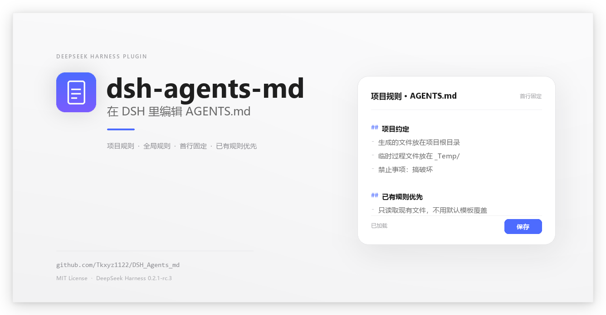
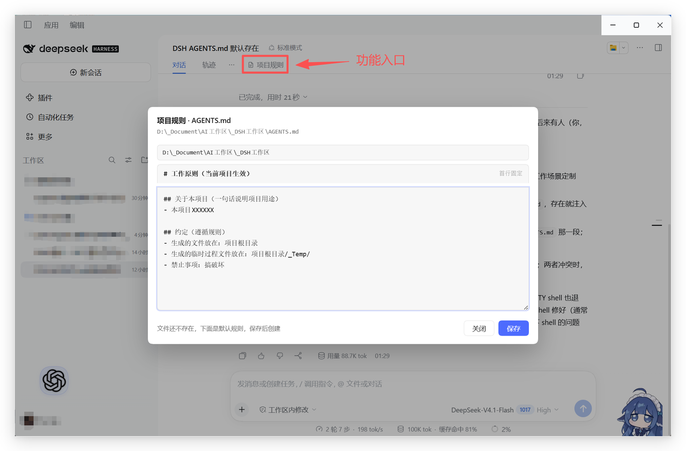
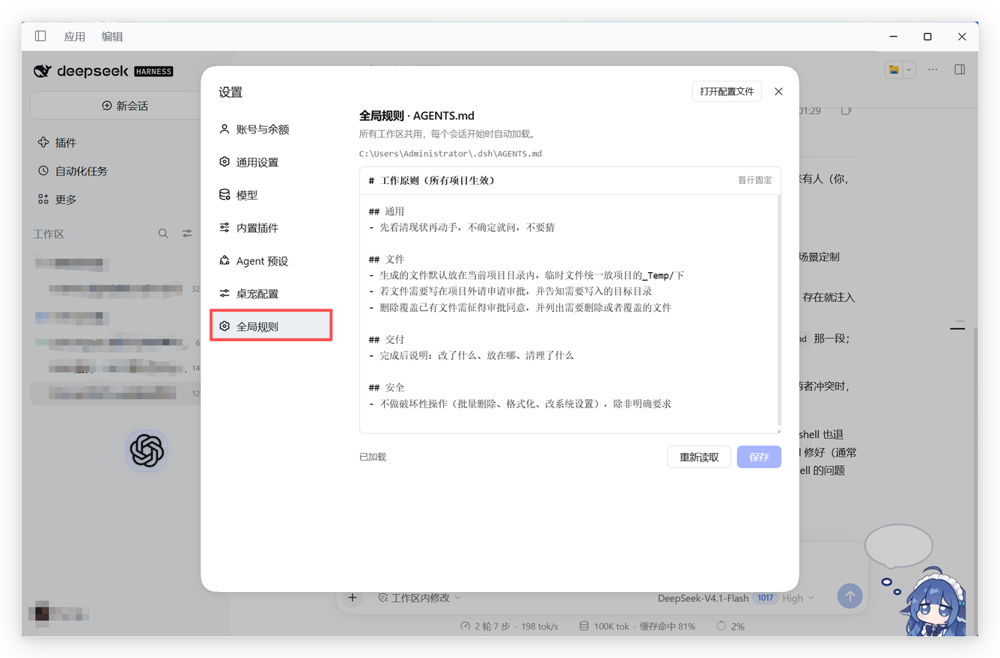
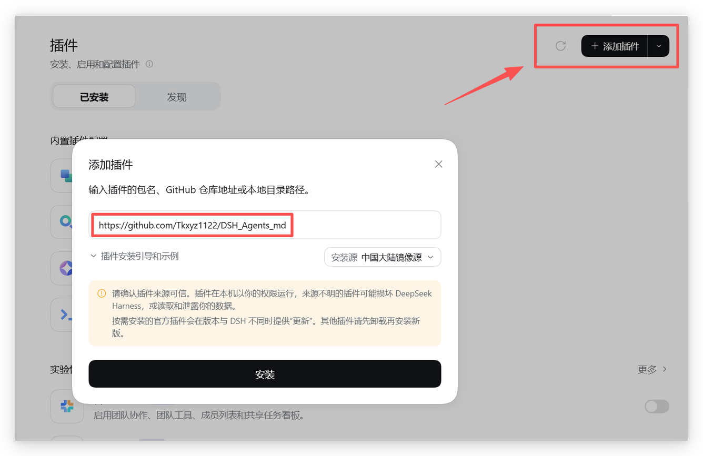

# dsh-agents-md

dsh-agents-md 是一个 DSH 客户端插件，把 AGENTS.md 的查看与编辑直接放进工作流：在会话标签行点「项目规则」，就能编辑当前对话所在项目的规则文件；在设置页的「全局规则」里，维护对所有项目生效的通用原则。

两个编辑器共用一套体验：首行固定标题不可改、正文随意编辑、`Ctrl+S` 保存。**已有规则优先**：目标文件存在时只读取并展示现有内容；只有文件不存在时才预填默认规则，并且要点保存才会创建。项目目录默认跟随当前对话，路径也可手动调整。

插件不会在安装、打开弹层或切换会话时自动写任何文件；只有点「保存」或按 `Ctrl+S` 才会写盘。

两个入口：

- **项目规则**：会话标签行右侧的按钮，新建 / 编辑**当前对话所在项目**的 `AGENTS.md`
- **全局规则**：设置页里的独立分区，编辑 `~/.dsh/AGENTS.md`

## 界面

**项目规则**：会话标签行右侧入口，弹层里读取并编辑当前项目的 `AGENTS.md`。



**全局规则**：设置页左侧的独立分区，编辑 `~/.dsh/AGENTS.md`。



## 特性

- 标签行按钮与「对话 / 轨迹」同字号、同基线、同间距，带文档图标和悬停胶囊
- 编辑器跟随 DSH 的浅色 / 深色主题
- 全局规则与项目规则互不干扰；项目里的规则更具体，优先于全局
- 首行固定标题，保存时强制写回，避免出现两个 H1
- **已有规则优先**：只读取现有文件，不会用默认模板覆盖；默认模板仅在文件不存在时使用
- 保存前校验目标文件状态：读取时不存在的文件若在保存前已被创建，返回冲突并重新读取，不做覆盖
- 项目目录默认取**当前打开对话**所属工作区，弹层顶部也能手动改
- 文件不存在时预填内置默认规则（见下文）
- 原子写入（先写临时文件再改名），内容上限 1 MB
- 接口只接受本机回环、同源请求，不联网

## 安装（桌面客户端）

两种方式任选其一；装完都要**完全退出客户端（含托盘）再重新打开**才生效。

### 方式一：从 GitHub 安装（推荐，不依赖源码目录）

在客户端「插件」页右上角点「添加插件」，输入仓库地址 `https://github.com/Tkxyz1122/DSH_Agents_md`（也支持 `github:Tkxyz1122/DSH_Agents_md` 简写）后点「安装」：



也可以在 profile 目录里执行（命令行里没有 `pnpm` 时用前一种）：

```powershell
cd "$env:USERPROFILE\.dsh\profiles\desktop"
pnpm add github:Tkxyz1122/DSH_Agents_md
```

装好后 `node_modules\dsh-agents-md` 是实体副本，源码目录可以随意移动或删除；升级方式见下文「升级」一节。

### 方式二：从本地目录链接安装（改代码时用）

1. 把本仓库放到任意目录，例如 `D:\plugins\dsh-agents-md`。

2. 链接进桌面 profile 的 `node_modules`：

   ```powershell
   cmd /c mklink /J "%USERPROFILE%\.dsh\profiles\desktop\node_modules\dsh-agents-md" "D:\plugins\dsh-agents-md"
   ```

3. 在 `%USERPROFILE%\.dsh\profiles\desktop\package.json` 里登记插件：

   ```json
   {
     "dependencies": {
       "dsh-agents-md": "link:D:\\plugins\\dsh-agents-md"
     },
     "dsh": {
       "profile": {
         "bundles": ["...原有插件...", "dsh-agents-md"]
       }
     }
   }
   ```

4. 完全退出客户端（含托盘）后重新打开。

> 用客户端的「插件」页从本地目录安装也可以，本质同样是 link + bundles 登记。
> 这种方式下插件始终读取源码目录：改完代码后宿主半区要完全重启才生效（`assets/agents-widget.js` 刷新页面即可）；源码目录被移动或删除，插件就失效了。

## 升级

- 正常情况下，DSH 客户端更新只替换应用本体，不会删除 profile 里的插件；更新后完全重启客户端即可。
- 升级本插件：在 profile 目录执行 `pnpm update dsh-agents-md`（或在客户端「插件」页重装），再完全重启客户端。
- 客户端更新不会自动升级插件；插件版本以安装时锁定的 commit 为准。

## 使用

1. 打开任意会话，点标签行右侧的「项目规则」：
   - 路径默认是当前对话所在项目，也可在弹层顶部改成别的目录；改完路径要按回车重新读取；
   - 项目里已经有 `AGENTS.md` 时，正文框显示现有内容，保存只更新这份文件；
   - 项目里没有 `AGENTS.md` 时，正文框才预填默认规则，点「保存」才会创建。
2. 打开「设置 → 全局规则」，编辑 `~/.dsh/AGENTS.md`。

两个编辑器的首行都是固定标题，**可见但不可编辑**：

| 范围 | 固定首行 |
|---|---|
| 全局 | `# 工作原则（所有项目生效）` |
| 项目 | `# 工作原则（当前项目生效）` |

保存时由宿主拼回这一行；已有文件如果首行是别的 H1，会被替换掉，不会出现重复标题，其余正文原样保留。

## 写入策略

一次编辑固定按「先读、后写」执行：

1. 打开编辑器只读取目标文件，不写盘；文件存在就显示现有内容，默认模板不参与。
2. 只有确认文件不存在时才显示默认模板；保存时请求会带 `createOnly`。
3. 宿主写盘前再检查一次：目标位置一旦已有文件（例如另一个窗口刚创建），立即返回 409 并停止覆盖；项目弹层会自动重新读取，设置页会提示点「重新读取」。
4. 项目规则弹层里手动改了目录但没有按回车重新读取时，保存会被拒绝，避免把 A 项目的规则写到 B 项目。

插件只读写目标目录下的 `AGENTS.md`，不碰其它规则文件（例如 `CLAUDE.md`、`.cursorrules`）。

因此安装插件、打开弹层或切换会话都不会改动已有的 AGENTS.md。

## 默认规则

仅当目标文件不存在时，编辑器才预填下面的正文（固定首行单独写入）；默认内容不会自动保存，需要手动点保存。

<details>
<summary>全局默认正文</summary>

```markdown
## 通用
- 先看清现状再动手，不确定就问，不要猜

## 文件
- 生成的文件默认放在当前项目目录内，临时文件统一放项目的_Temp/下
- 若文件需要写在项目外请申请审批，并告知需要写入的目标目录
- 删除覆盖已有文件需征得审批同意，并列出需要删除或者覆盖的文件

## 交付
- 完成后说明：改了什么、放在哪、清理了什么

## 安全
- 不做破坏性操作（批量删除、格式化、改系统设置），除非明确要求
```

</details>

<details>
<summary>项目默认正文</summary>

```markdown
## 关于本项目（一句话说明项目用途）
- 本项目XXXXXX

## 约定（遵循规则）
- 生成的文件放在：项目根目录
- 生成的临时过程文件放在：项目根目录/_Temp/
- 禁止事项：搞破坏
```

</details>

如需修改内置默认模板，编辑 `lib/index.js` 里的 `DEFAULT_GLOBAL_BODY` 与 `DEFAULT_PROJECT_BODY` 两个常量（开发向）。

## 项目目录是怎么定位的

弹层打开时，宿主按顺序尝试：

1. 弹层顶部手填的目录（最高优先级）
2. 窗口标题（= 当前对话标题）→ 在 `~/.dsh/storages/session_projcache` 找到该会话的 `cwd`
3. 最近有写入的会话 → 用 `~/.dsh/storages/workspace.json` 映射到工作区路径
4. 最近更新的工作区

定位依赖会话缓存：标题重复时会取最近写入的那一份；定位不准时在弹层顶部手动改路径，按回车重新读取。

## 目录结构

```text
dsh-agents-md/
├── package.json
├── cordis.patch.yml        # bundle 挂载声明
├── icon.png
├── lib/
│   ├── index.js            # 宿主：/dsh-agents/* 路由 + 前端注入
│   └── client.js           # 客户端：设置页「全局规则」分区
├── assets/
│   └── agents-widget.js    # 标签行按钮 + 项目规则编辑弹层
├── docs/
│   ├── cover.png           # README 封面
│   └── screenshots/        # README 截图
│       ├── install-from-github.png
│       ├── project-rules.png
│       └── global-rules.png
├── LICENSE
└── README.md
```

## 宿主路由

| 路由 | 方法 | 用途 |
|---|---|---|
| `/dsh-agents/state?scope=global\|project&dir=&title=` | GET | 读取目标文件路径、是否存在、固定首行、正文、默认正文 |
| `/dsh-agents/save` | POST `{scope, dir, title, body, createOnly?}` | 写入 AGENTS.md；`createOnly: true` 时若目标已存在返回 409，不覆盖 |
| `/dsh-agents/widget.js` | GET | 标签行按钮脚本 |

## 兼容与限制

- 需要带 `settings.section` 槽位和 `webserver/index-inject` 注入点的 DSH 桌面客户端
- 安装或升级后必须完全重启客户端才生效
- 只在桌面端做过完整验证；`dsh web` 形态保留了注入逻辑，但未做完整回归
- 链接安装始终读取源码目录；从 GitHub / tarball 安装的是实体副本，不依赖源码目录
- 同一份已有 AGENTS.md 被多个窗口同时编辑时没有文件锁，后保存的会覆盖先保存的；首次创建有存在性校验，不会用默认模板盖掉刚出现的文件
- 不访问网络，不收集任何数据；所有读写都发生在本地

## License

[MIT](LICENSE)
